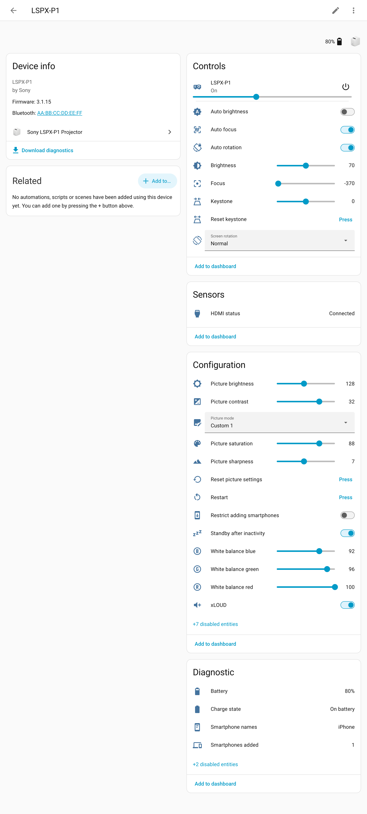
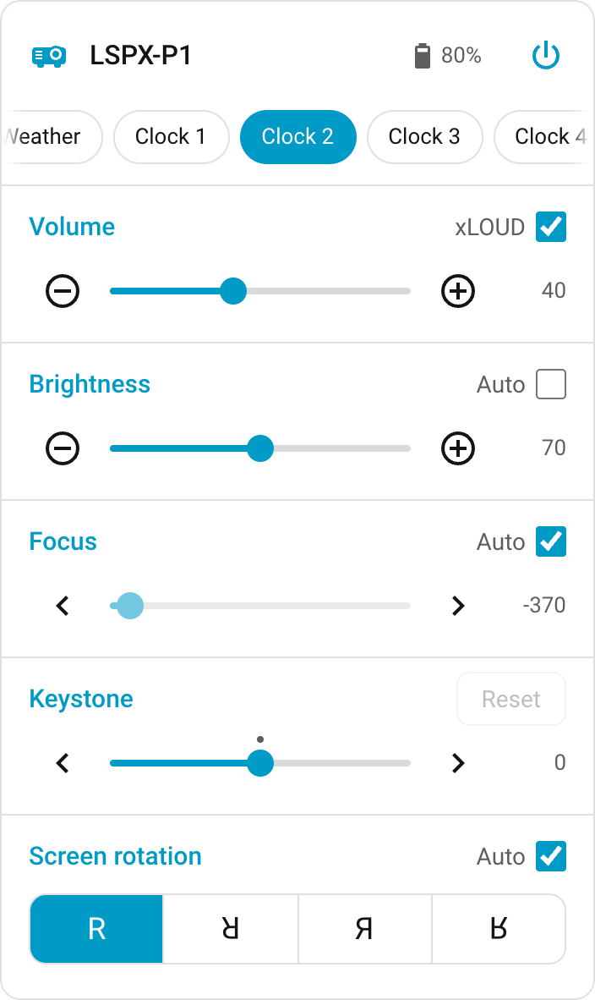
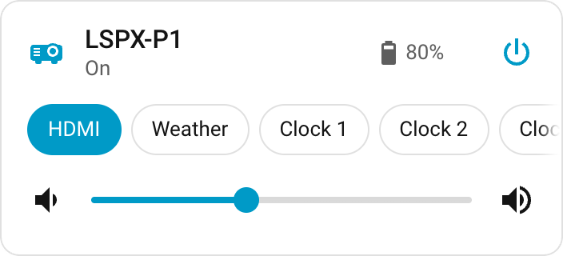
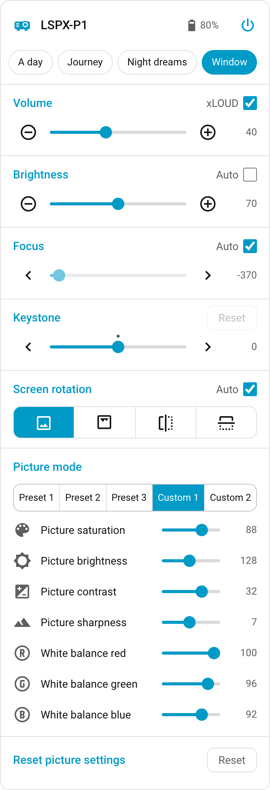
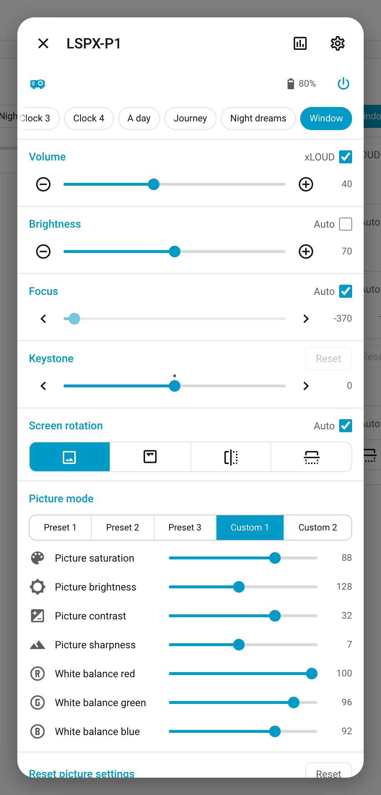

# Sony LSPX-P1 for Home Assistant

<p align="center">
  
</p>

Control the [Sony LSPX-P1 portable ultra short throw projector](https://helpguide.sony.net/projector/lspxp1/v1/en/index.html) from Home Assistant over Bluetooth, without the smartphone app and without putting the projector on Wi-Fi. Everything on the app's control panel (the screen with the sliders) is available, plus picture settings and battery status, both as regular entities and in a [dashboard card](#dashboard-card).

<!-- HTML rather than a Markdown table: only HTML can top-align the images (valign), so the headings line up. -->
<table>
  <tr><th>Device page</th><th>Dashboard card</th></tr>
  <tr>
    <td valign="top"></td>
    <td valign="top"></td>
  </tr>
</table>

The entities (Usage time, Bluetooth signal and the timers are disabled by default: to use one, open the projector's device page, find it under "+N disabled entities" in its section, open its settings and switch **Enabled** on):

| Entity | What it does |
| --- | --- |
| Media player | Power (on ↔ standby), volume, and the source: HDMI or one of the app's posters (Weather, Clock 1–4, A day, Journey, Night dreams, Window). Choosing a source in standby switches the projector on first. A switch takes 15–20 seconds; sources chosen meanwhile (or while the projector starts up) are not queued: only the latest is sent once it can be, and the actions of the ones it replaced return without error (once a switch in progress is done). Its `starting_up` attribute is true while the projector [starts up](#how-it-works). |
| Brightness | Projection brightness; moving it switches Auto brightness off |
| Focus | Manual focus; moving it switches Auto focus off |
| Keystone | Keystone correction |
| Screen rotation | Normal, upside down, mirrored; choosing one switches Auto rotation off |
| Auto brightness, Auto focus, Auto rotation | The app's "Auto" checkboxes |
| Picture mode | Preset 1–3, Custom 1–2 |
| Picture saturation, brightness, contrast, sharpness, white balance (R, G, B) | Tuning for the Custom picture modes (unavailable in Preset modes) |
| Reset keystone, Reset picture settings | The app's Reset buttons |
| Restart | Restarts the projector. Experimental: taken from the official app's code and tried twice; settings and pairings stay. Its source shows again after about a minute. It stays pressable while the projector does not answer. |
| Sync clock | Sets the projector's clock now, over Bluetooth. Experimental, see [Clock](#clock). |
| Initial mode, Slideshow interval | What the projector shows when it is switched on, and how long each slideshow photo stays up. Experimental, see [Timers and poster settings](#timers-and-poster-settings). |
| Switch on at a set time, Standby at a set time, Switch-on time, Standby time | The app's daily timers. Disabled by default and experimental, see [Timers and poster settings](#timers-and-poster-settings). |
| xLOUD | Sony's loudness enhancement |
| Battery, Charge state | Battery level and whether it is charging |
| HDMI status | The wireless HDMI unit: off (not set up), disconnected, source unplugged, no signal, connecting, connected, changing resolution or source, updating. While HDMI shows, read every 20 seconds, so it follows a source being plugged in and out within about that; disable it to stop those extra reads. |
| Usage time | How many hours the projector has been on in total, to 0.1 h (6 minutes). Disabled by default. |
| Bluetooth signal | How strongly Home Assistant hears the projector, in dBm, through the Bluetooth adapter or proxy that hears it best and can connect to it (see [Limitations](#limitations); [diagnostics](#troubleshooting) list them all). Read from the advertisements Home Assistant already receives, once a minute and whenever one changes, so it adds no Bluetooth traffic, and it keeps showing while the projector does not answer. Unavailable when Home Assistant stops hearing the projector, possibly also while the phone app stays connected to it (a connected device need not advertise). Disabled by default. |
| Standby after inactivity | The app's "Switch to Networked Standby after inactivity": the screen goes off after a while in the dark without interaction |
| Restrict adding smartphones | The app's setting of the same name: when on, a new phone has to enter a PIN shown by the projector. Phones already added and Home Assistant keep working. |
| Connection | Whether the last poll reached the projector, and if not, why not as far as Home Assistant can tell: **OK**, **Not heard** (no adapter or proxy that can connect hears it: switched off, battery flat or out of range), **Probably in use elsewhere** (it went quiet, less than 12 hours ago, while heard well and with a battery that was not running out: most likely another device, such as Sony's app, is connected to it, as a projector serves one connection and stops advertising meanwhile; but one switched off or carried away quickly looks the same), **Refusing connections** (heard well, but no connection gets a link), **Needs pairing** (see **Asked to pair again** under [Troubleshooting](#troubleshooting)), **Not responding** or **Connection error** (anything else, such as no free connection slot on the adapters and proxies, or a link that failed after it was made). Available while everything else is unavailable, and the card shows it in place of "Unavailable". While polls fail, its `error` attribute holds the last one's error, without Bluetooth addresses (empty once a poll gets through). |
| Smartphones added, Smartphone names | How many controllers are registered (Home Assistant included), and their names as one comma-separated text. The count's attributes also list the names, any blocked ones separately, and each entry's ID (`smartphone_ids`) for [removing or blocking smartphones](#removing-or-blocking-smartphones). |

## Requirements

- Home Assistant 2025.4 or newer with the [Bluetooth integration](https://www.home-assistant.io/integrations/bluetooth/) working.
- A Bluetooth adapter or an [ESPHome Bluetooth proxy](https://esphome.io/components/bluetooth_proxy.html) (with `active: true`) within range of the projector.
- The projector itself (not the wireless unit) must be in range. Projector firmware 3.1.15 has been tested.
- Only the LSPX-P1 is supported, not other Sony projectors.

## Installation

### Marketplace

[](https://my.home-assistant.io/redirect/marketplace_repository/?owner=kachkaev&repository=ha-sony-lspx-p1&category=integration)

1. Click the button above, or go to **Settings → Marketplace → Add from link** and enter `https://github.com/kachkaev/ha-sony-lspx-p1`.
2. Install **Sony LSPX-P1 Projector**.

On Home Assistant 2026.10 and older, use HACS (the Marketplace's predecessor) instead: menu → **Custom repositories** → add the URL above as an **Integration**, install, then restart Home Assistant.

### Manual

Copy `custom_components/sony_lspx_p1` into your Home Assistant `config/custom_components` folder and restart.

## Setup

1. Switch the projector on (projecting or in standby).
2. In the smartphone app, make sure **Settings → Network → Restrict adding smartphones** is off.
3. Home Assistant discovers the projector automatically: **Settings → Devices & services** shows it as discovered. If not, add the integration manually:

   [](https://my.home-assistant.io/redirect/config_flow_start/?domain=sony_lspx_p1)

4. Confirm the pairing step. Home Assistant registers itself as a controller called "Home Assistant", the same way a phone does; it appears in the app under **Smartphones added** (the projector keeps up to 8).

If you later remove "Home Assistant" from the list (or reset the projector), Home Assistant asks you to pair again once the projector has rejected it twice with no successful poll in between (one rejection may have gone through a Bluetooth adapter or proxy without the pairing, see [Limitations](#limitations)). It may instead only show the projector as unavailable (see **Asked to pair again** under [Troubleshooting](#troubleshooting)). Before pairing, it checks whether the projector accepts it again, for example after you set its entry back to **Allow** in the app, and then pairs only if it does not, to avoid adding a second entry.

The integration is available in English, German, French, Spanish, Italian, Dutch, Polish, Portuguese (Brazil), Swedish, Danish, Norwegian, Czech, Ukrainian, Russian, Chinese (Simplified) and Japanese.

## Dashboard card

The integration comes with a card laid out like the app's control panel. It uses your Home Assistant theme, so it works in light and dark mode.
Edit a dashboard, **Add card**, and pick **Sony LSPX-P1 Projector** (no extra resources to add). Or in YAML:

```yaml
type: custom:sony-lspx-p1-card
entity: media_player.lspx_p1_6320 # your projector's media player
layout: standard # compact, standard or full
name: Living room projector # optional: the title in the card and its dialog; the device's name by default
```

Every layout starts with the projector's name, battery and power button, and a row of sources: HDMI and the app's posters. The row scrolls sideways (swipe, or use the mouse wheel) and opens with the current source in view; faded edges show there is more. The sources are available once the projector is on: switch it on with the power button first. The chips show the poster names in your Home Assistant language; automations and the media player use the English names (Home Assistant cannot translate a media player's sources). A muted word under the name tells the state: "On", "Standby", or "Unavailable" while Home Assistant cannot reach the projector; after it is switched on or restarted, "Starting up" until it shows its source (a few seconds, or about a minute after a long standby or Restart; a source chosen meanwhile stays chosen until the projector shows it).

| Layout | Shows, below the sources |
| --- | --- |
| `compact` | A volume slider between quieter and louder buttons |
| `standard` | The app's control panel: volume (with xLOUD), brightness, focus, keystone and screen rotation, each with its Auto checkbox or Reset button |
| `full` | Everything in `standard`, plus picture mode, the Custom mode sliders (saturation, brightness, contrast, sharpness, white balance) and the picture Reset |

<table>
  <tr><th><code>compact</code></th><th><code>standard</code></th><th><code>full</code></th></tr>
  <tr>
    <td valign="top"></td>
    <td valign="top"></td>
    <td valign="top"></td>
  </tr>
</table>

Moving a slider whose Auto checkbox is ticked unticks it, as in the app.

Tap the projector's icon or name to see everything: from the `compact` and `standard` layouts this opens the full controls in a dialog, whose top bar has the battery, the power button and buttons for the projector's history and settings; from the `full` layout it opens Home Assistant's own dialog for the projector. Tap the battery for its own dialog and history.



## Removing or blocking smartphones

Seen to work on one projector (firmware 3.1.15): blocking, allowing and removing another controller's entry, and refusing to remove Home Assistant's own.

Three actions change the projector's **Smartphones added** list, like the app's Settings → Network → Smartphones added screen: `sony_lspx_p1.remove_smartphone` (the app's "Delete smartphone"), `sony_lspx_p1.block_smartphone` ("Deny": the phone stays in the list but cannot control the projector) and `sony_lspx_p1.allow_smartphone` ("Allow"). They are handy for the stale "Home Assistant" entries left behind when pairing is redone through another Bluetooth adapter or proxy (see [Limitations](#limitations)).

Each takes the projector's device and the entry's ID. The IDs are in the `smartphone_ids` attribute of the **Smartphones added** sensor (Developer tools → States), for example `{25905: iPhone, 45853: Home Assistant, 3079: Home Assistant}`. Home Assistant refuses to remove or block the entry it uses itself, so with two "Home Assistant" entries, removing the wrong one just fails with an error and changes nothing.

```yaml
action: sony_lspx_p1.remove_smartphone
data:
  device_id: 0123456789abcdef0123456789abcdef # pick the projector in the UI editor
  smartphone_id: 3079
```

The list is read back afterwards, so the sensors update at once. A removed phone has to be paired again (in the app) to control the projector.

## Weather poster

The Weather poster shows the weather the smartphone app last sent. Home Assistant can keep it up to date from one of your weather entities instead: **Settings → Devices & services → Sony LSPX-P1 Projector**, **Configure** (the cog next to the projector), choose the **Weather entity** and submit. Home Assistant then sends the entity's condition, but only while the Weather poster is shown: when you choose the poster in Home Assistant, whenever the condition changes, and when the poster appears some other way (chosen in the app or on the projector, or shown when it switches on) holding another picture than the current one. While HDMI or another poster shows, nothing is sent. Clear the field to stop; without a weather entity, Home Assistant leaves the poster alone.

It uses a projector command found in the official app's code, which the app itself does not use ([#2](https://github.com/kachkaev/ha-sony-lspx-p1/issues/2)). The projector stores the new picture at once but draws it only when the Weather poster is shown again. So after a change while the poster is up, Home Assistant shows the Clock 1 poster and then the Weather poster again (each switch takes a few seconds), as the app does with a blank poster of its own, which cannot be chosen over Bluetooth. Switching through Clock 1 is what was seen to redraw the Weather poster on a projector. Clock 1 does not count as a clock poster shown here, so it does not set the projector's clock. The media player keeps showing the Weather poster as its source meanwhile, and power changes and sources chosen meanwhile wait for it. Home Assistant first checks that the Weather poster still shows, so a projector switched off by its button in the meantime stays off. If the projector does not take the Weather poster back, a warning is logged, the source shows what the projector shows, and Home Assistant puts the Weather poster back if a poll begun within the next 90 seconds still finds Clock 1, every poll since found it, and no other source was chosen in Home Assistant meanwhile. Clock 1 chosen in the smartphone app in that time cannot be told apart and is replaced too; after 90 seconds, or if the projector went to standby during the switch or since, Clock 1 is left as it is (after a standby, switching on onto it counts as a clock poster appearing, as any power-on does).

The poster has 11 pictures of its own; each condition gets the one that looks nearest:

| Condition | Picture (code) |
| --- | --- |
| Sunny | A forest on a clear day (1) |
| Clear night | Sunset by a swimming pool (2) |
| Partly cloudy, windy | Bright and a bit cloudy, by the ocean (4) |
| Cloudy, windy and cloudy | Rain clouds over a field, no rain (5) |
| Fog | Fog in a forest (3) |
| Rainy | A tree in the rain (7) |
| Pouring | Heavy rain in a dark forest (9) |
| Hail, sleet (snowy and rainy) | Drops running down a window, heavy rain (8) |
| Lightning, lightning and rain | Lightning over a rainforest (10) |
| Snowy | Snow on spruce branches (11) |
| Exceptional | No change |

Diagnostics (on the device page) show the condition, the code last sent (or found on the projector) and the code the projector reports back.

## Clock

Experimental: seen to work on one projector, see below for what was not tried.

The clock posters (Clock 1–4) show the projector's own clock, which only the smartphone app sets, without a time zone: left alone, it drifts and stays an hour out after each daylight-saving change. Home Assistant sets it to Home Assistant's local time, over Bluetooth, the way the app does when it has no Wi-Fi to the projector (through the projector's Bluetooth link to its HTTP interface), so the projector does not need to be on Wi-Fi:

- when it sees a clock poster appear (chosen in Home Assistant, the app or on the projector, or shown when it switches on),
- once a day, and on the first poll after Home Assistant's UTC offset changes (daylight saving, or another time zone in Home Assistant's settings),
- and whenever you press **Sync clock** (on the device page, under Configuration). Where the integration was set up while the button was still disabled by default, it stays disabled until you enable it there under "+N disabled entities"; the automatic updates above run either way.

Only while the projector is on and ready: not in standby, and not while it starts up (**Sync clock** says so then). The automatic updates also wait for a poster to show (not HDMI or another app); **Sync clock** tries whatever shows. Tried on one projector (firmware 3.1.15), on and showing Clock 1: the clock poster jumped to the time sent within about a second. Not tried yet: while it shows HDMI, on other firmware, and what the projector answers when it cannot. If setting it fails, the automatic updates quietly try again later (after 5 minutes, then hourly), and **Sync clock** says what went wrong. Home Assistant sends local wall-clock time and no time zone, as the app does; the projector reported the time zone `GMT+0`. A projector holding another time zone might show the time shifted by it (not seen; diagnostics show the time zone it reports).

If the projector does not offer this or refuses it (not seen), Home Assistant cannot set its clock, and says so: **Sync clock** shows the error, and diagnostics (on the device page) show it too, with the last time sent and what the projector answered.

## Timers and poster settings

Experimental: seen to work on one projector (firmware 3.1.15), where both settings were changed and put back and timers switched it to standby and on at their times. Not checked: whether Sony's app shows the same timers, and what the slideshow interval changes on the photo posters.

The smartphone app keeps some settings in the projector's HTTP interface rather than behind its Bluetooth commands. Home Assistant reads and changes them over Bluetooth, through the same link to that interface as the [clock](#clock), so the projector does not need to be on Wi-Fi:

| Entities | App setting |
| --- | --- |
| Initial mode | Settings → "Initial mode": the last mode displayed, or a poster, when the projector is switched on or wakes from Networked Standby |
| Slideshow interval | Poster/slideshow settings → "Photo display time", in seconds: the app offers 10 seconds, 5, 15 or 30 minutes, 1 or 12 hours, or any time up to 11:59:59. Probably also used by the photo posters (A day, Journey, Night dreams, Window). Needs projector firmware 2.0.0 or later. |
| Switch on at a set time, Switch-on time | Settings → Startup/Networked Standby settings → "On at a specified time" |
| Standby at a set time, Standby time | "Switch to Networked Standby at a specified time" |

The timer entities are **disabled by default**: the app sends the initial mode and the slideshow interval this way too, but the timers only over Wi-Fi. To use them, open the projector's device page, find them under "+N disabled entities" in its Configuration section, open each one's settings and switch **Enabled** on. Where the integration was set up before this version, Initial mode and Slideshow interval stay disabled until you enable them the same way.

Home Assistant reads each setting whose entity is enabled right after a regular poll that finds the projector on, ready and showing a poster (not HDMI or another app): the first time, then hourly. It keeps what it read while the projector is in standby or shows something else. A setting the projector does not answer stays unavailable and is asked again after an hour, then once a day; one it answered before keeps its value and is asked hourly. Nothing else in the integration depends on them. Changes work whatever the projector shows, but not in standby or while it starts up (Home Assistant says so then).

The timers switch the projector on, or to Networked Standby, every day at that time, by themselves, even when Home Assistant is not running (an automation that calls `media_player.turn_on` at a set time does the same while Home Assistant runs). Set the time first, then switch the timer on; changing the time of a timer that is on takes effect at once. The time is Home Assistant's local time: the projector's own clock decides when a timer fires, so keep it in sync ([Clock](#clock)). Like the app, Home Assistant writes each timer as a week of single alarms and keeps a week ahead while one of these entities is enabled, whenever the projector shows a poster (every other day it removes the past days and adds the missing ones); a timer the projector has not been told about for a week stops, as with the app, so a projector that shows only HDMI for a week needs a poster shown in between. A change that fails part way reports an error and may leave the timer firing at both the old and the new time; Home Assistant finishes it with the next reads (an hour later, then once more a day later) and otherwise, from then on, keeps the timer at the time last set.

If the projector does not offer this or refuses it, the entities stay unavailable (or keep what was read before), and a change reports an error. Diagnostics show what was read and the last errors.

## Automation examples

Show a clock when the HDMI source has had no signal for ten minutes, and switch to standby at night:

```yaml
- alias: Projector clock when HDMI is idle
  triggers:
    - trigger: state
      entity_id: sensor.lspx_p1_6320_hdmi_status
      to: no_signal
      for: "00:10:00"
  actions:
    - action: media_player.select_source
      target:
        entity_id: media_player.lspx_p1_6320
      data:
        source: Clock 1 # or HDMI, Weather, Clock 2–4, A day, Journey, Night dreams, Window

- alias: Projector standby at night
  triggers:
    - trigger: time
      at: "23:30:00"
  actions:
    - action: media_player.turn_off
      target:
        entity_id: media_player.lspx_p1_6320
```

## How it works

The integration talks to the projector over Bluetooth LE using the same protocol as the official app, documented in [docs/protocol.md](docs/protocol.md).
It polls once a minute (and a few extra times right after switching power) and disconnects a couple of seconds after each poll, or about 15 seconds after you change something, so the smartphone app and Bluetooth proxy slots stay free.
While HDMI shows and the HDMI status sensor is enabled, it also reads that status alone twice between polls (every 20 seconds), each time disconnecting a couple of seconds after; if one of these reads fails (say, because the smartphone app is connected), the rest wait for the next poll.
When the projector reports a change of power or source while connected, Home Assistant polls again sooner (experimental: firmware 3.1.15 sent no such report when its power button was pressed while a computer listened).
Woken from standby after more than about half an hour (not after a few minutes), the projector reports on at once, but its source and HDMI status stay unknown until it is ready: on one projector (firmware 3.1.15) that took about 45 seconds each of the four times it was timed closely (two more power-ons fit too), while volume and picture settings worked. A source chosen meanwhile is sent within about 10 seconds of that and then takes the usual 15–20 seconds to switch (choose another before then and only the latest is sent; the earlier choice's action returns without error); if it is not ready within two minutes, the choice fails with "still starting up" (or, made in standby, is dropped with a warning in the log). After Restart the projector starts up the same way (seen twice: about 50 s, once followed by about 13 s more before its source came back), and a source chosen is sent once the source is back; if the projector answers but shows nothing within two minutes, the choice is sent then, and if it does not answer at all, the choice fails with "still starting up". From switching on (or Restart) until the projector shows its source, the media player's `starting_up` attribute is true and the card says "Starting up"; it also turns false when Home Assistant stops waiting after those two minutes, so false alone does not mean a source shows. Tried on a real projector: a source chosen right after switching on, chosen in standby, and chosen right after Restart (once each).
Everything goes over Bluetooth, [setting the clock](#clock) and the [timers and poster settings](#timers-and-poster-settings) too: the integration sends nothing to the projector over Wi-Fi.
While the projector cannot be reached (fully switched off or out of range), its entities (except Restart and Connection) show as unavailable; they come back with the next poll that reaches it. Connection says why, as far as Home Assistant can tell.

## Limitations

- **Sony's "On when smartphone detected" and "Switch to Networked Standby when your smartphone moves out of range" may not work as expected with Home Assistant** (Settings → Startup/Networked Standby settings). The projector does not tell the phone from other controllers: in one test a computer running the integration's client switched it on by connecting after 7 minutes in standby, and connecting once a minute kept it from going to standby when the phone left ([details](docs/protocol.md#smartphone-detection)). Home Assistant's own polls were not tried; if the projector switches itself on or does not go to standby, switch these two off.
- Home Assistant sets the clock posters' time over Bluetooth, which was seen to work on one projector only ([Clock](#clock), experimental, [#1](https://github.com/kachkaev/ha-sony-lspx-p1/issues/1)); over Bluetooth it does not set the projector's time zone. The Weather poster follows Home Assistant only with a [weather entity chosen](#weather-poster). Custom posters and slideshows are not supported.
- The daily timers, the initial mode and the slideshow interval go over Bluetooth to the projector's HTTP interface, which was seen working for the clock only ([Timers and poster settings](#timers-and-poster-settings), experimental; the timers are disabled by default, [#5](https://github.com/kachkaev/ha-sony-lspx-p1/issues/5), [#6](https://github.com/kachkaev/ha-sony-lspx-p1/issues/6)). They are read hourly and only while the projector shows a poster, so a change made in the app shows up to an hour later. The slideshow interval needs projector firmware 2.0.0 or later.
- Fully switching the projector off (long press of its power button) cannot be undone remotely; Home Assistant switches between on and standby.
- Tested with Home Assistant OS on a Raspberry Pi (built-in Bluetooth adapter) and with Home Assistant on macOS. ESPHome Bluetooth proxies (a recent ESPHome version with `active: true`) support the pairing this integration needs, but pairing through a proxy has not been verified yet; reports are welcome.
- Pairing can take up to a minute. On Linux, the integration briefly registers its own Bluetooth pairing agent while pairing (Home Assistant OS does not run one), approving pairing with the projector only.
- The pairing is stored by the Bluetooth adapter or proxy that made it. If Home Assistant later reaches the projector through a different adapter or proxy, the projector rejects it. One such connection only makes the entities unavailable until the next poll, if that one goes through the adapter or proxy that holds the pairing. When the strongest adapter lacks it, every connection usually goes through that one, and Home Assistant asks you to pair again after two polls; pairing then adds another "Home Assistant" entry under **Smartphones added**. Remove stale entries there, or [from Home Assistant](#removing-or-blocking-smartphones).
- When more than one Bluetooth adapter or proxy can connect to the projector, Home Assistant picks one for each connection attempt, by signal strength but passing over one that is busy connecting, has no free connection slot or has failed to connect to the projector more than once; integrations cannot choose one or keep to one. So even a much weaker proxy is sometimes tried first, and when it cannot reach the projector, the next attempt, a few seconds later, goes elsewhere: the command then takes several seconds longer. [Diagnostics](#troubleshooting) list the adapters and proxies that can connect to the projector and how strongly they hear it; in the debug log, `Found … connection path(s), preferred order` shows how Home Assistant ranked them for each attempt. To keep connections off an ESPHome proxy, set `active: false` under its `bluetooth_proxy`: it still passes on what it hears but no longer makes connections, for any device, so check that nothing else needs it for that. Making the adapter that holds the pairing the strongest helps only while it is idle.

## Troubleshooting

- **Entities unavailable with "The projector did not respond"**: the projector's internal link can get stuck (the official app then stops responding too). Press the recessed **RESET** button next to the DC IN jack; settings and pairings survive. If this lasts for several minutes, Home Assistant also raises a repair issue (Settings → Repairs) with these instructions; it can try Restart first, then wait up to about two minutes for the projector to respond and say whether that helped. Whether Restart gets through to a stuck projector has not been seen yet (if you try it, please report the outcome in [#40](https://github.com/kachkaev/ha-sony-lspx-p1/issues/40)). It is not sent to a projector that is off, out of range or already starting up, and the RESET button stays the fix when it does not help.
- **Entities unavailable**: the **Connection** sensor (on the device page, under Diagnostic, and in the card in place of "Unavailable") says why, as far as Home Assistant can tell. **Probably in use elsewhere** was seen while Sony's app was connected: the projector stopped advertising until the app was closed. The app can stay connected from the background, for example on an iPhone that lets it use the location at all times; closing it, and allowing it the location never or only while in use, gives the connection back. If either **Probably in use elsewhere** (for a projector last seen on its charger: one on battery may simply have been carried off) or **Refusing connections** lasts more than 20 minutes, a repair issue (Settings → Repairs) says what to try; it goes away once Home Assistant reaches the projector again, or once the status is another one, and comes back the next time (ignoring it lasts until then).
- **Pairing fails**: check that "Restrict adding smartphones" is off, that the projector is switched on, and that it is close to the Bluetooth adapter or proxy. Close Sony's app on the phone too (swipe it away), or switch the phone's Bluetooth off while pairing: the projector serves one connection at a time. If "Home Assistant" was deleted under **Smartphones added** while the computer Home Assistant runs on kept its Bluetooth pairing, the projector drops every connection from that adapter; the integration then removes that old pairing itself when it pairs (not yet tried on a projector). This covers adapters of that computer only, not ESPHome proxies.
- **Asked to pair again**: if "Home Assistant" is still under **Smartphones added** but set to **Deny**, set it to **Allow** in the app and then submit; Home Assistant finds it accepted again and does not pair. With several adapters or proxies, see [Limitations](#limitations). With a deleted or blocked entry, though, the projector does not let Home Assistant connect at all (a deleted entry seen through a Raspberry Pi's adapter, a blocked one from macOS; proxies not tried, nor one forgotten after a reset; [#41](https://github.com/kachkaev/ha-sony-lspx-p1/issues/41)). For a deleted entry, Home Assistant asks to pair again when its adapter (BlueZ) holds the old pairing and every try to connect drops as it is made, in three polls in a row (not yet tried on a projector); otherwise the **Connection** sensor shows **Refusing connections** or **Not heard**, and deleting the projector's entry in Home Assistant ([Removal](#removal), step 1) and adding it again helps. For a blocked one, set it to **Allow**. A debug log of such a case is welcome.
- Diagnostics are available from the device page (⋮ → Download diagnostics). Besides the projector's state, they show which Bluetooth adapters and proxies hear it and how strongly, and since the integration was last loaded: connections and how long they took, lost links, timeouts, rejected commands and the last ten polls. Bluetooth addresses and smartphone names are left out. When reporting a problem with the connection or a command, also enable debug logging (⋮ on the integration's page), reproduce it and attach the log: it shows every command with how long it took and how it ended, and which adapter or proxy each connection went through. The log does contain Bluetooth addresses; edit them out before posting it publicly.

## Removal

1. **Settings → Devices & services → Sony LSPX-P1 Projector**, then ⋮ next to the projector → **Delete**.
2. In the smartphone app, remove "Home Assistant" under **Smartphones added**, so that it no longer takes one of the 8 places.
3. To remove the files too, uninstall the integration in the Marketplace (or HACS), or delete `config/custom_components/sony_lspx_p1` if you copied it by hand, and restart Home Assistant. Remove the dashboard cards that use `custom:sony-lspx-p1-card` as well.

<!-- ha-marketplace:exclude-start -->

## Development

```bash
uv venv --python 3.14 .venv
uv pip install --python .venv -r requirements_test.txt
.venv/bin/pytest # --cov for test coverage
.venv/bin/ruff check . && .venv/bin/ruff format --check .
.venv/bin/mypy # strict, for custom_components/sony_lspx_p1
```

`tools/lspx_cli.py` drives a projector from the command line with the integration's own client (it needs a terminal that is allowed to use Bluetooth):

```bash
.venv/bin/python tools/lspx_cli.py pair --name "My laptop"
.venv/bin/python tools/lspx_cli.py state
.venv/bin/python tools/lspx_cli.py set brightness 70
.venv/bin/python tools/lspx_cli.py power off --watch 10
.venv/bin/python tools/lspx_cli.py controllers   # "Smartphones added" with ids, marking this controller
.venv/bin/python tools/lspx_cli.py remove 3079   # or block / allow; never this controller's own entry
.venv/bin/python tools/lspx_cli.py weather 7   # send a Weather poster code (1–11); without one, read it
.venv/bin/python tools/lspx_cli.py weather 7 --redraw   # and show the poster again as Home Assistant does
.venv/bin/python tools/lspx_cli.py probe   # every read-only command in turn, written to lspx-probe-<date>-<time>.txt
```

### At the projector

Several issues need someone looking at the projector ([#1](https://github.com/kachkaev/ha-sony-lspx-p1/issues/1), [#2](https://github.com/kachkaev/ha-sony-lspx-p1/issues/2), [#9](https://github.com/kachkaev/ha-sony-lspx-p1/issues/9), [#14](https://github.com/kachkaev/ha-sony-lspx-p1/issues/14), [#5](https://github.com/kachkaev/ha-sony-lspx-p1/issues/5), [#6](https://github.com/kachkaev/ha-sony-lspx-p1/issues/6); with a phone and Sony's app also [#4](https://github.com/kachkaev/ha-sony-lspx-p1/issues/4), [#41](https://github.com/kachkaev/ha-sony-lspx-p1/issues/41) and [#42](https://github.com/kachkaev/ha-sony-lspx-p1/issues/42)). `tools/at_projector.py` walks through those checks in one sitting of about 45 minutes, 70 with the optional steps; one sitting has been done, and more, on other projectors and firmware, are welcome:

1. Once, register the computer with the projector (an entry "Home Assistant (dev)" under **Smartphones added**, next to the others). Use a computer other than the one Home Assistant runs on.

   ```bash
   .venv/bin/python tools/lspx_cli.py pair
   ```

   - Switch **Restrict adding smartphones** off in Sony's app first. Or, with it on, switch the projector on first: macOS asks for a passcode, and the projector shows it (six digits) on its picture; in standby it has none, and pairing fails after timeouts.
   - Close Sony's app on the phone (swipe it away): while it was open, `pair` once did not find the projector at all.
   - On macOS, a **Connection Request** window from the projector appears during pairing: click **Connect**. It goes away by itself after a few seconds; if it did, run `pair` again and be quicker.

2. In Home Assistant, free the projector's one Bluetooth connection: **Settings → Devices & services → Sony LSPX-P1 Projector**, ⋮ on the projector's entry → **Disable**. Close Sony's app on the phone.
3. From a terminal that may use Bluetooth, near the projector:

   ```bash
   .venv/bin/python tools/at_projector.py
   ```

4. Answer each question with its letter, optionally followed by a note (`y 11:20 on a 12-hour face`), then Enter; where it asks what the picture shows, type a few words instead. `s` skips a step, `q` ends the session. During a wait, Enter ends the wait early, and `s` and `q` work too.
5. Paste `.at-projector/<date-time>/shareable.md` (addresses and names left out) into the issues. `results.json`, `frames.jsonl` and `client.log` beside it have everything, unredacted; the folder is git-ignored.
6. Give the connection back: the same page in Home Assistant, the disabled entry → **Enable**.

In order: the Weather poster's pictures for codes 1–11, each shown by switching to Clock 1 and back to the Weather poster (#2), the clock over the Bluetooth tunnel, set 90 minutes back and returned (#1), the picture direction, notifications from the power button (#9), and the HDMI status while a source is plugged in and out (#14, needs an HDMI source). The first sitting (firmware 3.1.15) is written up in [docs/protocol.md](docs/protocol.md). `--list` shows what each settles and how long it takes; `--step weather,clock` runs only some.

Then, over the Bluetooth tunnel: the initial mode and the slideshow interval (#6), timers of the session's own, made, watched and deleted (#5), and reads on HDMI and in standby. Three optional steps follow, skipped unless you type `y`: the smartphone detection switches (#42), and blocking, allowing and finally removing the computer's own entry (#4, #41), which you do in Home Assistant or Sony's app. Removing it is not undone: register the computer again afterwards.

Each step puts back the settings it changed, except that removal, the clock Sony's app sets when it opens and a timer the projector will not delete (it fires once at most), and the end of the session puts back the source and the power, also on the first Ctrl-C (a second one quits at once). Switching on after a long standby takes 45–100 s and a switch to or from HDMI about 17 s, which the session waits for. The session never changes the volume, never sends Restart, never pairs and only reads **Smartphones added**. Run it again to continue where it stopped; `--new` starts over. If it could not put something back (the link lost for good, or the terminal closed), it says how to by hand, and `--restore-only` tries again.

`tools/probes/` holds the scripts used to reverse-engineer the protocol and `tools/control_panel/` a small web UI for testing.
`tools/brand/` has the sources of the brand icon and the README header (a 3D model rendered with three.js, plus a line-art alternative); see its README.
`tools/screenshots/` runs Home Assistant with a simulated projector and takes the README screenshots; see its README.
Its extra packages are installed with the constraints file that ships with the Home Assistant release the test requirements brought in, so the frontend and the rest match that release:

```bash
uv pip install --python .venv -r requirements_demo.txt \
  -c "$(.venv/bin/python -c 'import homeassistant, pathlib; print(pathlib.Path(homeassistant.__file__).parent / "package_constraints.txt")')"
```

<!-- ha-marketplace:exclude-end -->

## Disclaimer

This project is not affiliated with or endorsed by Sony. The protocol was worked out for interoperability with hardware the author owns. Use at your own risk.

## Licence

[BSD 3-Clause](LICENSE.md)
