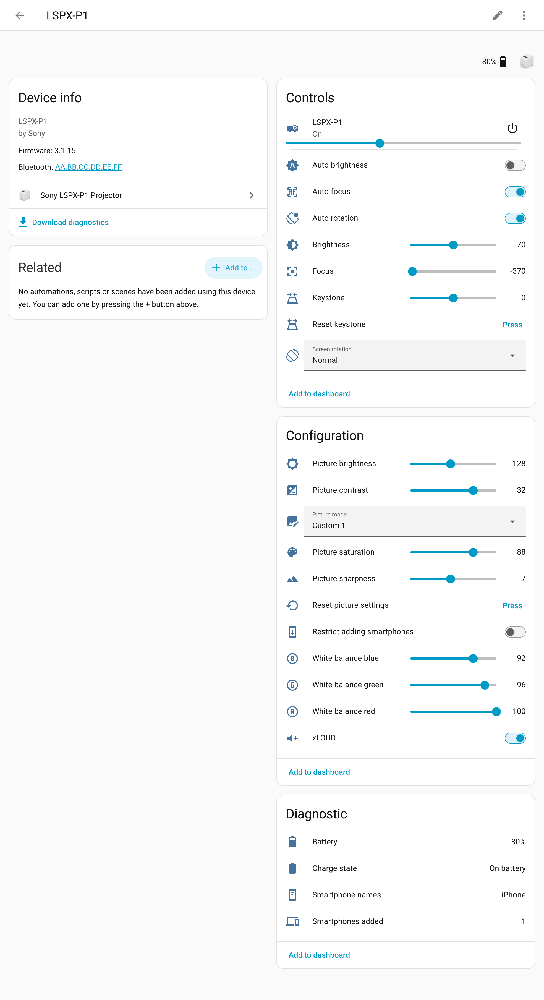
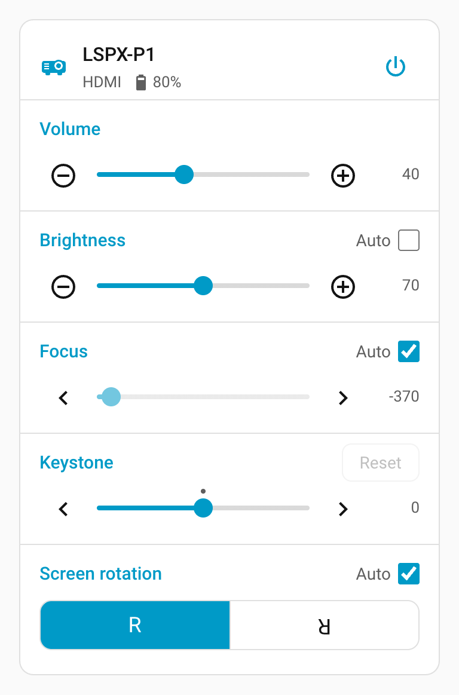
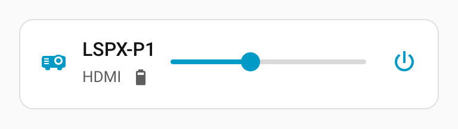
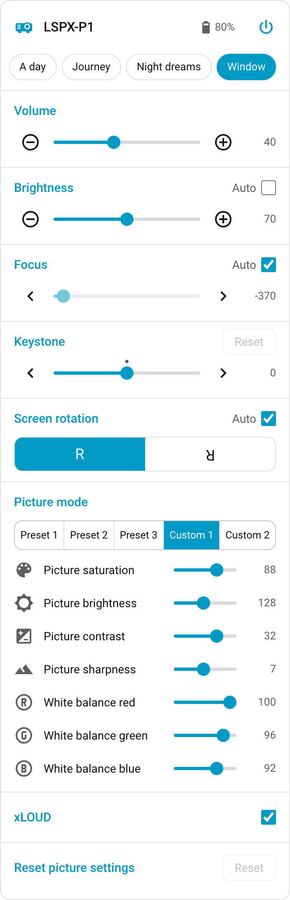
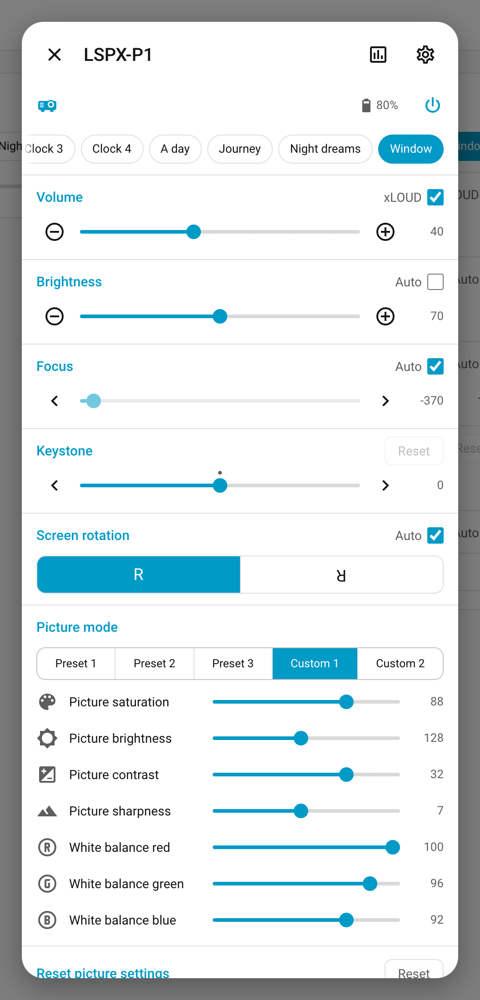

# Sony LSPX-P1 for Home Assistant

<p align="center">
  
</p>

Control the [Sony LSPX-P1 portable ultra short throw projector](https://helpguide.sony.net/projector/lspxp1/v1/en/index.html) from Home Assistant over Bluetooth, without the smartphone app and without putting the projector on Wi-Fi. Everything on the app's control panel (the screen with the sliders) is available, plus picture settings and battery status, both as regular entities and in a [dashboard card](#dashboard-card).

<!-- HTML rather than a Markdown table: only HTML can top-align the images (valign), so the headings line up. -->
<table>
  <tr><th>Device page</th><th>Dashboard card</th></tr>
  <tr>
    <td valign="top"></td>
    <td valign="top"></td>
  </tr>
</table>

The entities:

| Entity | What it does |
| --- | --- |
| Media player | Power (on ↔ standby), volume, and the source: HDMI or one of the app's posters (Weather, Clock 1–4, A day, Journey, Night dreams, Window). Choosing a source in standby switches the projector on first. |
| Brightness | Projection brightness; moving it switches Auto brightness off |
| Focus | Manual focus; moving it switches Auto focus off |
| Keystone | Keystone correction |
| Screen rotation | Normal, upside down, mirrored; choosing one switches Auto rotation off |
| Auto brightness, Auto focus, Auto rotation | The app's "Auto" checkboxes |
| Picture mode | Preset 1–3, Custom 1–2 |
| Picture saturation, brightness, contrast, sharpness, white balance (R, G, B) | Tuning for the Custom picture modes (unavailable in Preset modes) |
| Reset keystone, Reset picture settings | The app's Reset buttons |
| Restart | Restarts the projector. Experimental: taken from the official app's code and not yet tried on a projector. It stays pressable while the projector does not answer. |
| Sync clock | Sets the projector's clock now, over Wi-Fi. Experimental, see [Clock](#clock). |
| xLOUD | Sony's loudness enhancement |
| Battery, Charge state | Battery level and whether it is charging |
| HDMI status | The wireless HDMI unit: off (not set up), disconnected, source unplugged, no signal, connecting, connected, changing resolution or source, updating |
| Usage time | How many hours the projector has been on in total |
| Standby after inactivity | The app's "Switch to Networked Standby after inactivity": the screen goes off after a while in the dark without interaction |
| Restrict adding smartphones | The app's setting of the same name: when on, a new phone has to enter a PIN shown by the projector. Phones already added and Home Assistant keep working. |
| Smartphones added, Smartphone names | How many controllers are registered (Home Assistant included), and their names as one comma-separated text. The count's attributes also list the names, any blocked ones separately, and each entry's ID (`smartphone_ids`) for [removing or blocking smartphones](#removing-or-blocking-smartphones). |

## Requirements

- Home Assistant 2025.3 or newer with the [Bluetooth integration](https://www.home-assistant.io/integrations/bluetooth/) working.
- A Bluetooth adapter or an [ESPHome Bluetooth proxy](https://esphome.io/components/bluetooth_proxy.html) (with `active: true`) within range of the projector.
- The projector itself (not the wireless unit) must be in range. Projector firmware 3.1.15 has been tested.
- Only the LSPX-P1 is supported, not other Sony projectors.

## Installation

### Marketplace

[](https://my.home-assistant.io/redirect/marketplace_repository/?owner=kachkaev&repository=ha-sony-lspx-p1&category=integration)

1. Click the button above, or go to **Settings → Marketplace → Add from link** and enter `https://github.com/kachkaev/ha-sony-lspx-p1`.
2. Install **Sony LSPX-P1 Projector**.

On Home Assistant 2026.10 and older, use HACS (the Marketplace's predecessor) instead: menu → **Custom repositories** → add the URL above as an **Integration**, install, then restart Home Assistant.

### Manual

Copy `custom_components/sony_lspx_p1` into your Home Assistant `config/custom_components` folder and restart.

## Setup

1. Switch the projector on (projecting or in standby).
2. In the smartphone app, make sure **Settings → Network → Restrict adding smartphones** is off.
3. Home Assistant discovers the projector automatically: **Settings → Devices & services** shows it as discovered. If not, add the integration manually:

   [](https://my.home-assistant.io/redirect/config_flow_start/?domain=sony_lspx_p1)

4. Confirm the pairing step. Home Assistant registers itself as a controller called "Home Assistant", the same way a phone does; it appears in the app under **Smartphones added** (the projector keeps up to 8).

If you later remove "Home Assistant" from the list (or reset the projector), Home Assistant asks you to pair again.

The integration is available in English, German, French, Spanish, Italian, Dutch, Polish, Portuguese (Brazil), Swedish, Danish, Norwegian, Czech, Ukrainian, Russian, Chinese (Simplified) and Japanese.

## Removing or blocking smartphones

Experimental: taken from the official app's code and not yet tried on a projector.

Three actions change the projector's **Smartphones added** list, like the app's Settings → Network → Smartphones added screen: `sony_lspx_p1.remove_smartphone` (the app's "Delete smartphone"), `sony_lspx_p1.block_smartphone` ("Deny": the phone stays in the list but cannot control the projector) and `sony_lspx_p1.allow_smartphone` ("Allow"). They are handy for the stale "Home Assistant" entries left behind when pairing is redone through another Bluetooth adapter or proxy (see [Limitations](#limitations)).

Each takes the projector's device and the entry's ID. The IDs are in the `smartphone_ids` attribute of the **Smartphones added** sensor (Developer tools → States), for example `{25905: iPhone, 45853: Home Assistant, 3079: Home Assistant}`. Home Assistant refuses to remove or block the entry it uses itself, so with two "Home Assistant" entries, removing the wrong one just fails with an error and changes nothing.

```yaml
action: sony_lspx_p1.remove_smartphone
data:
  device_id: 0123456789abcdef0123456789abcdef # pick the projector in the UI editor
  smartphone_id: 3079
```

The list is read back afterwards, so the sensors update at once. A removed phone has to be paired again (in the app) to control the projector.

## Weather poster

Experimental: uses a projector command found in the official app's code (which the app itself does not use); not yet tried on a projector.

The Weather poster shows the weather the smartphone app last sent. Home Assistant can keep it up to date from one of your weather entities instead: **Settings → Devices & services → Sony LSPX-P1 Projector**, **Configure** (the cog next to the projector), choose the **Weather entity** and submit. Home Assistant then sends the entity's condition, but only while the Weather poster is shown: whenever the poster appears (chosen in Home Assistant, the app or on the projector, or shown when it switches on) and whenever the condition changes. While HDMI or another poster shows, nothing is sent. Clear the field to stop; without a weather entity, Home Assistant leaves the poster alone.

The poster has 11 pictures of its own; each condition gets the nearest one:

| Condition | Picture (code) |
| --- | --- |
| Sunny, clear night | Sunny (1) |
| Partly cloudy | Partly sunny (2) |
| Cloudy | Cloudy (5) |
| Fog, windy | Fog (6) |
| Rainy | Showers (7) |
| Pouring, hail, sleet (snowy and rainy) | Rain (8) |
| Lightning, lightning and rain | Thunderstorm (10) |
| Snowy | Snow (11) |
| Exceptional | No change |

Diagnostics (on the device page) show the condition, the code last sent and the code the projector reports back.

## Clock

Experimental: taken from the official app's code and not yet tried on a projector.

The clock posters (Clock 1–4) show the projector's own clock, which only the smartphone app sets, without a time zone: left alone, it drifts and stays an hour out after each daylight-saving change. When the projector is on your home Wi-Fi, Home Assistant sets it the way the app does, to Home Assistant's local time:

- when it sees a clock poster appear (chosen in Home Assistant, the app or on the projector, or shown when it switches on),
- once a day, and on the first poll after Home Assistant's UTC offset changes (daylight saving, or another time zone in Home Assistant's settings),
- and whenever you press **Sync clock** (on the device page, under Configuration).

Only while the projector is on and not showing HDMI. Home Assistant asks the projector over Bluetooth for its address on the network and sends the time there over HTTP (port 80), so Home Assistant has to be able to reach the projector's network. If the projector is not on Wi-Fi, the automatic updates quietly do nothing (they try again later), and **Sync clock** says why. Diagnostics (on the device page) show the projector's address, the last time sent and the last error.


The integration comes with a card laid out like the app's control panel. It uses your Home Assistant theme, so it works in light and dark mode.
Edit a dashboard, **Add card**, and pick **Sony LSPX-P1 Projector** (no extra resources to add). Or in YAML:

```yaml
type: custom:sony-lspx-p1-card
entity: media_player.lspx_p1_6320 # your projector's media player
layout: standard # compact, standard or full
```

Every layout starts with the projector's name, battery and power button, and a row of sources: HDMI and the app's posters. The row scrolls sideways (swipe, or use the mouse wheel) and opens with the current source in view; faded edges show there is more. Choosing a source in standby switches the projector on first. The chips show the poster names in your Home Assistant language; automations and the media player use the English names (Home Assistant cannot translate a media player's sources).

| Layout | Shows, below the sources |
| --- | --- |
| `compact` | A volume slider between quieter and louder buttons |
| `standard` | The app's control panel: volume (with xLOUD), brightness, focus, keystone and screen rotation, each with its Auto checkbox or Reset button |
| `full` | Everything in `standard`, plus picture mode, the Custom mode sliders (saturation, brightness, contrast, sharpness, white balance) and the picture Reset |

<table>
  <tr><th><code>compact</code></th><th><code>standard</code></th><th><code>full</code></th></tr>
  <tr>
    <td valign="top"></td>
    <td valign="top"></td>
    <td valign="top"></td>
  </tr>
</table>

Moving a slider whose Auto checkbox is ticked unticks it, as in the app.

Tap the projector's icon or name to see everything: from the `compact` and `standard` layouts this opens the full controls in a dialog, with buttons for the projector's history and settings; from the `full` layout it opens Home Assistant's own dialog for the projector. Tap the battery for its own dialog and history.



## Automation examples

Show a clock when the HDMI source has had no signal for ten minutes, and switch to standby at night:

```yaml
- alias: Projector clock when HDMI is idle
  triggers:
    - trigger: state
      entity_id: sensor.lspx_p1_6320_hdmi_status
      to: no_signal
      for: "00:10:00"
  actions:
    - action: media_player.select_source
      target:
        entity_id: media_player.lspx_p1_6320
      data:
        source: Clock 1 # or HDMI, Weather, Clock 2–4, A day, Journey, Night dreams, Window

- alias: Projector standby at night
  triggers:
    - trigger: time
      at: "23:30:00"
  actions:
    - action: media_player.turn_off
      target:
        entity_id: media_player.lspx_p1_6320
```

## How it works

The integration talks to the projector over Bluetooth LE using the same protocol as the official app, documented in [docs/protocol.md](docs/protocol.md).
It polls once a minute (and a few extra times right after switching power) and disconnects a couple of seconds after each poll, or about 15 seconds after you change something, so the smartphone app and Bluetooth proxy slots stay free.
Only [setting the clock](#clock) also uses the projector's Wi-Fi (HTTP), and only when the projector is on a Wi-Fi network.
While the projector cannot be reached (fully switched off or out of range), its entities (except Restart) show as unavailable; they come back with the next poll that reaches it.

## Limitations

- Home Assistant sets the clock posters' time only while the projector is on Wi-Fi and reachable from Home Assistant ([Clock](#clock), experimental); otherwise they show the time the smartphone app last sent. Setting it over Bluetooth alone is not supported yet ([#1](https://github.com/kachkaev/ha-sony-lspx-p1/issues/1)). The Weather poster follows Home Assistant only with a [weather entity chosen](#weather-poster), which is experimental ([#2](https://github.com/kachkaev/ha-sony-lspx-p1/issues/2)). Custom posters and slideshows are not supported.
- Fully switching the projector off (long press of its power button) cannot be undone remotely; Home Assistant switches between on and standby.
- Tested with Home Assistant OS on a Raspberry Pi (built-in Bluetooth adapter) and with Home Assistant on macOS. ESPHome Bluetooth proxies (a recent ESPHome version with `active: true`) support the pairing this integration needs, but pairing through a proxy has not been verified yet; reports are welcome.
- Pairing can take up to a minute. On Linux, the integration briefly registers its own Bluetooth pairing agent while pairing (Home Assistant OS does not run one), approving pairing with the projector only.
- The pairing is stored by the Bluetooth adapter or proxy that made it. If Home Assistant later reaches the projector through a different adapter or proxy, the projector rejects it and Home Assistant asks you to pair again, which adds another "Home Assistant" entry under **Smartphones added**. Remove stale entries there, or [from Home Assistant](#removing-or-blocking-smartphones).

## Troubleshooting

- **Entities unavailable with "The projector did not respond"**: the projector's internal link can get stuck (the official app then stops responding too). Press the recessed **RESET** button next to the DC IN jack; settings and pairings survive. If this lasts for several minutes, Home Assistant also raises a repair issue (Settings → Repairs) with these instructions.
- **Pairing fails**: check that "Restrict adding smartphones" is off, that the projector is switched on, and that it is close to the Bluetooth adapter or proxy.
- Diagnostics are available from the device page (⋮ → Download diagnostics).

## Removal

1. **Settings → Devices & services → Sony LSPX-P1 Projector**, then ⋮ next to the projector → **Delete**.
2. In the smartphone app, remove "Home Assistant" under **Smartphones added**, so that it no longer takes one of the 8 places.
3. To remove the files too, uninstall the integration in the Marketplace (or HACS), or delete `config/custom_components/sony_lspx_p1` if you copied it by hand, and restart Home Assistant. Remove the dashboard cards that use `custom:sony-lspx-p1-card` as well.

<!-- ha-marketplace:exclude-start -->

## Development

```bash
uv venv --python 3.14 .venv
uv pip install --python .venv -r requirements_test.txt
.venv/bin/pytest # --cov for test coverage
.venv/bin/ruff check . && .venv/bin/ruff format --check .
.venv/bin/mypy # strict, for custom_components/sony_lspx_p1
```

`tools/lspx_cli.py` drives a projector from the command line with the integration's own client (it needs a terminal that is allowed to use Bluetooth):

```bash
.venv/bin/python tools/lspx_cli.py pair --name "My laptop"
.venv/bin/python tools/lspx_cli.py state
.venv/bin/python tools/lspx_cli.py set brightness 70
.venv/bin/python tools/lspx_cli.py power off --watch 10
.venv/bin/python tools/lspx_cli.py controllers   # "Smartphones added" with ids, marking this controller
.venv/bin/python tools/lspx_cli.py remove 3079   # or block / allow; never this controller's own entry
.venv/bin/python tools/lspx_cli.py weather 7   # send a Weather poster code (1–11); without one, read it
.venv/bin/python tools/lspx_cli.py endpoint   # the projector's address on its Wi-Fi network
.venv/bin/python tools/lspx_cli.py set-time --shift 90   # set its clock over Wi-Fi, 90 minutes ahead; get-time reads it
```

`tools/probes/` holds the scripts used to reverse-engineer the protocol and `tools/control_panel/` a small web UI for testing.
`tools/brand/` has the sources of the brand icon and the README header (a 3D model rendered with three.js, plus a line-art alternative); see its README.
`tools/screenshots/` runs Home Assistant with a simulated projector and takes the README screenshots; see its README.

<!-- ha-marketplace:exclude-end -->

## Disclaimer

This project is not affiliated with or endorsed by Sony. The protocol was worked out for interoperability with hardware the author owns. Use at your own risk.

## Licence

[BSD 3-Clause](LICENSE.md)
