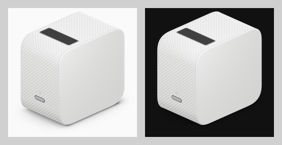

# Brand icon sources

These are the sources for the integration's brand icon (`custom_components/sony_lspx_p1/brand/icon.png` and `icon@2x.png`) and for the README header image. The header shows the Home Assistant logo next to the projector.



All geometry here is original. It was modelled from the projector's published dimensions (80 × 131 × 131 mm) and from photos, with the viewing angle taken from the pictograms in Sony's Reference Guide. No Sony artwork, photos, logos or traced outlines are included. The Home Assistant logo is not included either: `build.py` downloads it from `brands.home-assistant.io` at build time.

## Files

| File | What it is |
| --- | --- |
| `scene.html` | The 3D model and render setup: three.js 0.170.0, pinned and loaded from cdn.jsdelivr.net. Open it in a browser to see the render. URL options: `?size=2048`, `?shadow=none\|extra-subtle\|subtle\|medium\|strong`, `?export=glb`. |
| `build.py` | Renders `scene.html` with headless Chromium and writes `out/brand/icon.png` (256 px) and `out/brand/icon@2x.png` (512 px). Also writes `out/readme-header.png` (the README lockup), and optionally the README mock-ups and `lspx-p1.glb`. |
| `lspx-p1.glb` | The same model exported as binary glTF at real size (metres, Y-up, front facing +Z). Opens in Blender and other tools. |
| `lineart/build_lineart.py`, `lineart/iso_model.py` | Generator for the flat black-and-white line-art alternative. Pure Python: the projection is computed, not traced. |
| `lineart/a1-line.svg` … `a5-line-glass.svg` | The line-art set: a1 line, a2 line with perforation, a3 two-tone, a4 two-tone with a glass window, a5 line with a glass window. |
| `preview.png` | The current icon on light and dark backgrounds. |

## Regenerating

Requirements:

- Python 3.9+ with Pillow.
- A Chromium-based browser that can run headless:
  - Google Chrome, Chromium, or Playwright's `chrome-headless-shell`;
  - `build.py` looks in the usual places, or pass `--chrome PATH` or set `CHROME`.
- Network access to cdn.jsdelivr.net (three.js) and brands.home-assistant.io (HA logo).
- For the line art: `rsvg-convert` (librsvg), used to trim the SVGs.

```sh
python build.py                     # out/brand/icon.png, out/brand/icon@2x.png, out/readme-header.png
python build.py --mocks             # + readme-header-on-{light,dark}.png and readme-mock-{light,dark}.png
python build.py --glb               # + re-export lspx-p1.glb next to this file
python build.py --shadow subtle     # another shadow strength (default: medium)
python build.py --out /tmp/brand    # write somewhere else

python lineart/build_lineart.py         # rewrite lineart/a*.svg
python lineart/build_lineart.py --png   # + 256/512 px PNGs next to them
```

Copy `out/brand/icon*.png` to `custom_components/sony_lspx_p1/brand/`. Copy `out/readme-header.png` to wherever the README references it, for example `docs/images/readme-header.png`.

## Key parameters

### Model (`scene.html`)

| Part | Values |
| --- | --- |
| Body | 80 (W) × 131 (D) × 131 (H) mm. The side profile is a rounded square with superellipse corners (exponent 2.8, top 28 mm, bottom 30 mm), so the curves are continuous (G2). |
| Side panels | 4.2 mm thick with a 2 mm rounded edge. |
| Perforated band | Runs between the panels. The holes are a texture repeated every 2.6 mm (staggered), mapped by arc length so the pattern follows the curves without a seam. |
| Window | 58 × 19 mm of dark glass with a grey bezel, on the top just behind the front rounding. |
| Power button | 17 × 3.47 mm satin-metal pill. Its centre is 37.8 mm above the base. A 2.3 mm LED sits 8.1 mm above the top of the pill. |
| Panel/band junction | The band runs 0.15 mm under the panels' 2 mm rounded edges, so the model has no see-through gap. |
| Seam line | A deliberate hairline where each panel meets the band: an unlit 0.36 mm ribbon (`SEAM` in `scene.html`), grey #6c6c70 at 75% opacity. It is fully visible along the top and the top roundings, fades out smoothly (smoothstep) from the start of the top rounding (z = 103 mm) down to z = 42 mm, and is absent around the bottom rounding. |

### Camera

The camera is orthographic. It looks from front-right-above (azimuth 45°) at the elevation where the ground axes run at 24° to the horizontal, which matches the manual's pictogram. Height is drawn at 0.91 of its true value, also to match the pictogram. The `.glb` has true proportions.

### Lighting

- A room environment map and a soft key light from above.
- A point light that puts a gradient on the side panel.
- A small front light for the button highlight.
- Nothing casts a shadow.

### Contact shadow

The shadow is an ambient-occlusion-style ground texture made from three blurred copies of the base footprint:

| Layer | Blur | Opacity | Footprint inset |
| --- | --- | --- | --- |
| Tight | 2 mm | 0.55 | 15 mm in at the front |
| Mid | 5 mm | 0.28 | 9 mm in at the front |
| Wide | 16 mm | 0.16 | none |

- The wide layer is faded out by an elliptical mask that ends 40 mm beyond the footprint, so it never reaches the image edge.
- Strength multipliers: extra-subtle 0.35, subtle 0.6, **medium 1.0** (used), strong 1.45.

### Icon

The icon is square, trimmed to every non-transparent pixel, with 2% padding on each side. `build.py` checks that the outermost pixels are fully transparent.

### README lockup (`readme-header.png`)

- The HA logo is on the left. The projector is on the right with a gap of 30% of the HA logo's height.
- Optical alignment: the projector body (not its shadow) is 10% taller than the HA house. Its top vertex sits 4% above the roof apex and its bottom vertex 6% below the house base.
- It is one transparent PNG that works in both GitHub themes.

## What the `.glb` cannot carry

- **Lighting and environment:** the environment map and lights are not exported. A viewer applies its own.
- **Contact shadow:** it is a render-time ground texture, so the export has no shadow.
- **Height squash:** the 0.91 factor applies to the camera view only. The `.glb` is at true size.
- **Perforation:** the holes are a repeating 64 × 64 px texture tile (embedded in the `.glb`, sampler set to repeat), not real holes in the geometry.
- **Tessellation:** the export uses lighter tessellation than the render (25% of the profile samples, 3 bevel segments) to keep the file small.
- **Materials:** these are approximations: satin metal, glossy dark glass (clearcoat), and an emissive LED.
- **Seam lines:** included as two thin meshes (`seam-line-left` and `seam-line-right`). They use an unlit material with blended transparency (KHR_materials_unlit), and the fade is stored in the vertex colours' alpha. Some viewers ignore vertex-colour alpha and will show the line at full strength all the way round; hide those two meshes if that happens.
